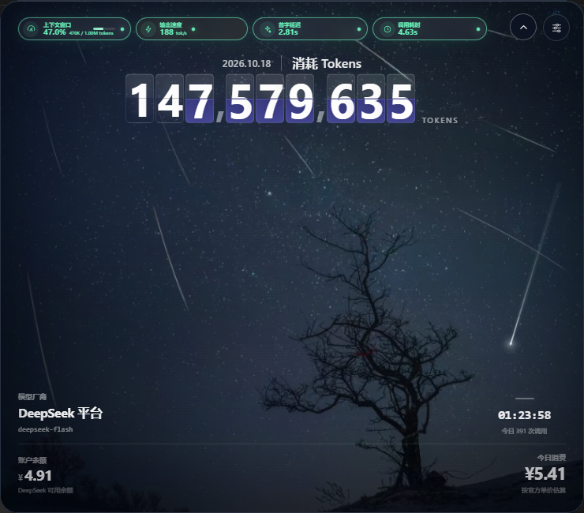

# DeepSeek Usage Monitor

[](https://github.com/ShenMingPro/deepseek-usage-monitor/actions/workflows/ci.yml)
[](https://github.com/ShenMingPro/deepseek-usage-monitor/releases)
[](LICENSE)

一个本地优先的 DeepSeek 模型用量监控面板。它读取 Codex 会话中的 Token 元数据，并通过
DeepSeek 官方余额接口显示账户余额，配有可置顶的 Windows 悬浮窗、系统托盘和桌面启动器。



> 本项目是独立第三方工具，与 DeepSeek、OpenAI 或 Microsoft 没有隶属或背书关系。

## 演示视频

[](https://github.com/ShenMingPro/deepseek-usage-monitor/releases/download/v1.0.1/deepseek-usage-monitor-demo.mp4)

▶ [观看 78 秒完整演示](https://github.com/ShenMingPro/deepseek-usage-monitor/releases/download/v1.0.1/deepseek-usage-monitor-demo.mp4)

视频从真实桌面启动器开始，依次展示悬浮窗指标、收起与展开、计费与连接设置、完整仪表盘、请求明细和会话完成动画。录制使用本地真实运行数据，侧栏会话 ID 已替换为 `demo-session`。

## 功能

- 今日 Tokens、调用次数、余额和今日消费总览
- 当前会话的上下文窗口、输出速度、首字延迟和调用耗时
- 输入、输出、推理、缓存命中与未命中 Token 明细
- 按缓存命中和未命中分别估算费用，支持 DeepSeek 高峰/空闲价格
- 每次模型调用完成后通过 SSE 自动刷新
- 一轮问题结束时播放双流星碰撞动画，展示本轮 Token 与缓存效率
- 可拖动、可收起、始终置顶的 WebView2 悬浮窗
- 系统托盘控制显示、隐藏、置顶、随 Codex 显示以及退出
- 请求明细、费用口径说明、CSV 导出、深浅主题和移动端布局
- 数据与服务默认只留在本机

## 系统要求

- Windows 10/11
- [Node.js](https://nodejs.org/) 18 或更高版本
- Microsoft Edge WebView2 Runtime（Windows 10/11 通常已安装）
- .NET Framework 4.8（仅从源码构建桌面组件时需要）

只是想查看网页面板时，Node.js 即可运行；悬浮窗、托盘和桌面启动器是 Windows 专属功能。

## 快速开始

### 使用发布包

1. 从 [Releases](https://github.com/ShenMingPro/deepseek-usage-monitor/releases) 下载
   `deepseek-usage-monitor-1.0.1-win-x64.zip`。
2. 解压到固定目录，不要直接在压缩包内运行。
3. 双击 `Start Monitor.cmd` 或 `DeepSeekLauncher.exe`。

发布包中的程序未做代码签名，Windows SmartScreen 可能显示“未知发布者”。如果你介意，可以按下面的步骤从源码构建。

### 从源码运行网页面板

```powershell
git clone https://github.com/ShenMingPro/deepseek-usage-monitor.git
cd deepseek-usage-monitor
npm start
```

然后访问 <http://127.0.0.1:4173>。

### 从源码运行悬浮窗

```powershell
npm install
npm run build
npm run widget
```

`npm run build` 会自动下载固定版本的 WebView2 SDK，并编译托盘程序、无边框窗口宿主和桌面启动器。

如需创建桌面快捷方式：

```powershell
npm run install:desktop
```

## 使用说明

### 收起与展开

- 展开状态下，点击卡片右上角的上箭头收起窗口。
- 收起后只显示上下文、输出速度、首字延迟和调用耗时四项指标。
- 点击收起横条右侧的下箭头恢复完整监控卡片。
- 窗口位置、尺寸和收起状态会自动记忆。
- 展开时可按住卡片空白区域移动窗口；收起时拖动顶部 14px 区域移动。

### 托盘菜单

- 显示监控面板 / 隐藏到托盘
- 窗口置顶
- 随 Codex 显示 / 隐藏
- 退出托盘程序

双击托盘图标也可以快速显示或隐藏窗口。使用 Windows 截图工具、Snipping Tool 或 Snipaste 时，窗口会临时取消置顶并暂停拦截鼠标，避免截图选区被窗口干扰。

### 随 Codex 会话自动打开

Windows 下可通过 Codex hooks 自动启动监控窗并同步当前会话：

- `SessionStart`：运行 `open-dashboard.ps1`，按需启动本地服务、托盘和悬浮窗。
- `UserPromptSubmit`：运行 `set-active-session.ps1`，把当前会话 ID 和 transcript 路径同步给监控服务。

hook 配置位于 `%USERPROFILE%\.codex\hooks.json`。请把脚本路径替换为本机仓库或解压目录的绝对路径，并在 Codex 的 Hooks 审核界面确认信任。Codex 官方目前不提供把常驻自定义网页直接嵌入聊天窗口的接口，因此这里使用生命周期 hook 打开独立桌面窗口。

## 数据来源

### 会话与 Token

默认读取：

```text
%USERPROFILE%\.codex\sessions
```

可通过 `CODEX_HOME` 修改 Codex 配置目录。面板只解析 `token_usage_record` 等 Token 元数据，不读取或展示聊天正文。

当前对话的输入、输出、上下文与费用取自当前 Codex 会话；每日统计会汇总当天所有 `deepseek-*` 模型会话，并自动排除其他模型。

### 余额

余额按以下顺序选择凭证：

1. 面板“计费与连接”中临时输入的 API Key
2. `DEEPSEEK_API_KEY` 环境变量
3. 本机 Codex `config.toml` 中的 DeepSeek Provider 凭证

凭证只在本地 Node 进程中使用，不会发送到前端页面，也不会写入页面或日志。临时输入的 Key 仅保存在当前服务进程内存中，服务重启后失效。

## 计费口径

单次费用：

```text
缓存命中输入 × 命中单价
+ 未命中输入 × 未命中单价
+ 输出 Token × 输出单价
```

默认使用 DeepSeek 官方人民币价格：

| 模型 | 缓存命中 | 缓存未命中 | 输出 |
| --- | ---: | ---: | ---: |
| deepseek-flash 空闲 | ¥0.02/M | ¥1/M | ¥4/M |
| deepseek-flash 高峰 | ¥0.04/M | ¥2/M | ¥8/M |
| deepseek-v4-pro 空闲 | ¥0.15/M | ¥4.50/M | ¥13.50/M |
| deepseek-v4-pro 高峰 | ¥0.30/M | ¥9/M | ¥27/M |

高峰时段按北京时间工作日 09:00–12:00、14:00–18:00 判断。法定节假日尚未单独处理，可在设置中手动切换计价时段。费用为本地估算，实际扣费以 DeepSeek 账单为准。

## 刷新机制

服务端通过 Server-Sent Events 监听当前会话文件：

- 发现新的 `token_usage_record`：立即刷新 Token 与费用
- 发现 `task_complete`：按 `turn_id` 汇总本轮问题，并在主卡内播放完成动画
- SSE 断开：使用设置中的定时刷新作为兜底

可在“计费与连接 → 监控偏好”中点击“预览会话结束动画”。

## 配置

| 变量 | 默认值 | 说明 |
| --- | --- | --- |
| `PORT` | `4173` | 本地服务端口 |
| `HOST` | `127.0.0.1` | 监听地址 |
| `CODEX_HOME` | `%USERPROFILE%\.codex` | Codex 数据目录 |
| `DEEPSEEK_API_KEY` | 空 | DeepSeek API Key |
| `DEEPSEEK_WIDGET_URL` | 内置地址 | 覆盖 WebView2 宿主加载的页面地址 |

## 开发

```powershell
npm test
```

检查内容：

- JavaScript 与 PowerShell 语法
- WebView2 SDK 恢复
- 托盘、悬浮窗宿主和启动器编译
- 本地服务健康检查

单独构建：

```powershell
npm run build:tray
npm run build:host
npm run build:launcher
```

生成可分发的 Windows 压缩包：

```powershell
npm run package
```

输出位于 `release/deepseek-usage-monitor-<version>-win-x64.zip`。该目录已被 `.gitignore` 排除。

## 项目结构

```text
deepseek-usage-monitor/
├─ .github/workflows/ci.yml       # Windows CI
├─ assets/                         # 夜空背景和启动器图标
├─ desktop/                        # WebView2 无边框窗口宿主
├─ docs/                           # README 截图与演示封面
├─ launcher/                       # 桌面启动器源码
├─ scripts/                        # 恢复、构建、验证和打包脚本
├─ tray/                           # Windows 托盘源码
├─ third_party/webview2/           # WebView2 许可证与声明
├─ app.js                          # 数据渲染、图表、SSE 与交互
├─ index.html                      # 页面结构
├─ server.js                       # 会话解析、余额接口、聚合与静态服务
├─ styles.css                      # 主题、悬浮卡片与夜空动画
├─ widget-mode.js                  # 独立窗口模式标记
├─ open-dashboard.ps1              # 启动本地服务和悬浮窗
├─ set-active-session.ps1          # 同步当前 Codex 会话
├─ widget-window.ps1               # 展开/收起窗口
├─ Start Monitor.cmd               # 发布包快速启动入口
└─ package.json
```

## 安全

服务默认只监听 `127.0.0.1`。如果改为对外监听，应先增加身份认证、HTTPS 和访问控制，否则不要把服务暴露到公网。安全问题请参阅 [SECURITY.md](SECURITY.md)。

## 参与贡献

欢迎提交 Issue 和 Pull Request。开始之前请阅读 [CONTRIBUTING.md](CONTRIBUTING.md)。

## 许可证

本项目使用 [MIT License](LICENSE)。第三方组件声明见 [THIRD_PARTY_NOTICES.md](THIRD_PARTY_NOTICES.md)。
